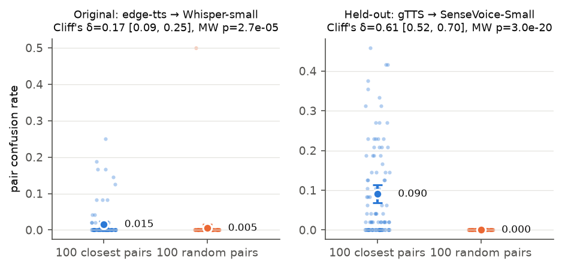
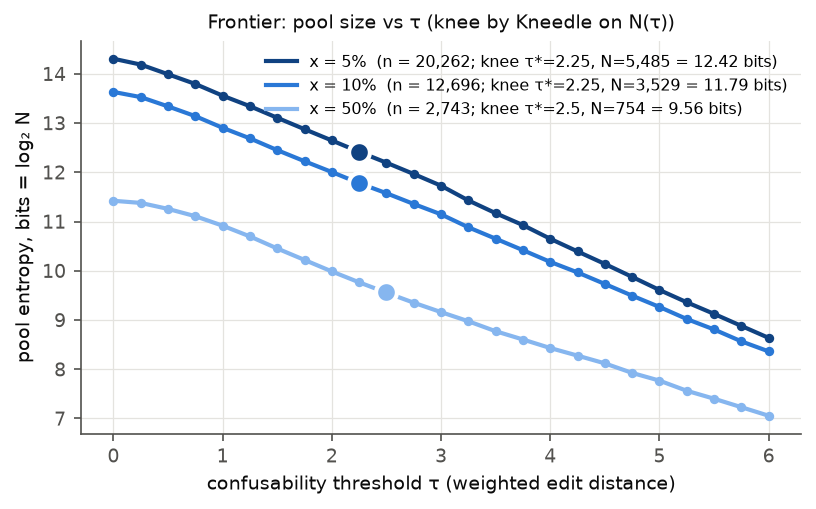
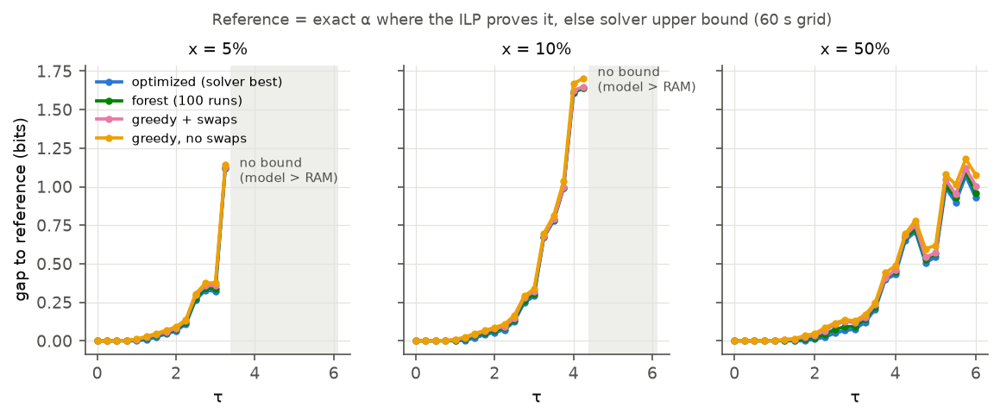
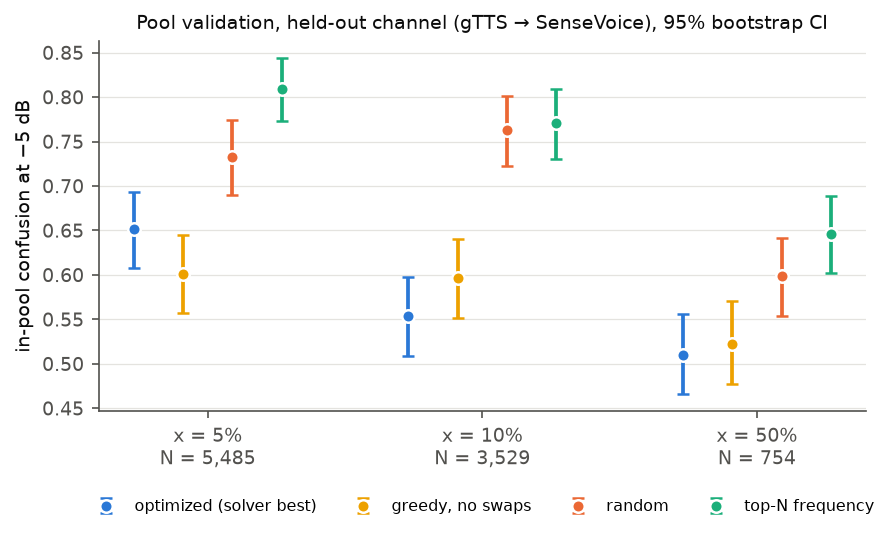

# Countersign pool — results

All numbers are read from `runs/`; every figure has a table next to it in this folder.

## Headline (x = 5%)

- Candidate set: **20,262** 2–3-syllable NNG lemmas from OpenSubtitles KO at or above the bottom-5% Zipf of
  the NIKL 2003 level-C anchors (1,518 of 1,670 anchors present in the corpus;
  cutoff Zipf 2.68 ≈ 3 occurrences).
- Knee τ* = **2.25** (Kneedle on N(τ)) → pool **N = 5,485, 12.42 bits**.
- 1 h ILP on the giant component (3,036 nodes): FEASIBLE, upper bound 5,894
  → remaining gap **409 words (0.104 bits)**.
- Held-out pool validation at −5 dB: optimized 0.65
  vs random 0.73 vs top-N frequency 0.81
  vs no-swap greedy 0.60 (N = 5,356).

## 1. Metric calibration (original channel)

GLM-weighted Manhattan edit distance (GAP = 3, CROSS = 6), fit on the nearest 10% of
11,781 pairs (427 pairs with any confusion). Adopted: `calibrated_raw`.

| feature | weight |
|---|---|
| c_place | 0.132 |
| c_manner | 0.472 |
| c_laryngeal | 0.380 |
| c_sonorant | 0.100 |
| v_height | 0.695 |
| v_backness | 0.100 |
| v_round | 0.100 |
| v_glide | 0.450 |

Spearman(distance, confusion) — weak for every variant:

| weights | spearman_d_vs_confusion |
|---|---|
| uniform | -0.047 |
| calibrated_raw | -0.089 |
| calibrated_norm | -0.072 |

Channel error by SNR (raw decision rule):

| snr_db | error_rate |
|---|---|
| 0 | 0.373 |
| -5 | 0.709 |
| -10 | 0.951 |
| -15 | 0.994 |

## 2. Metric validation — closest 100 vs random 100 pairs (Fig. 1)

| channel | group | pairs | mean_confusion | ci_lo | ci_hi | cliffs_delta | mw_p | channel_error_rate |
|---|---|---|---|---|---|---|---|---|
| original | closest | 100 | 0.0152 | 0.0071 | 0.0240 | 0.1682 | 0.0000 | 0.9697 |
| original | random | 100 | 0.0050 | 0.0000 | 0.0150 | 0.1682 | 0.0000 | 0.9697 |
| heldout | closest | 100 | 0.0904 | 0.0685 | 0.1138 | 0.6100 | 0.0000 | 0.8074 |
| heldout | random | 100 | 0.0000 | 0.0000 | 0.0000 | 0.6100 | 0.0000 | 0.8074 |

- Original: δ = 0.17 [0.09, 0.25], p = 2.7e-05;
  ratio 3.04 [0.64, 4.62] (undefined in 35% of bootstrap draws).
- Held-out: δ = 0.61 [0.52, 0.70], p = 3.0e-20;
  **ratio undefined** (random pairs never confused).
- Pairs whose words failed the clean-audio gate were replaced from a reserve: 29 closest, 24 random.

## 3. Grid, frontier and knees (Figs. 2–3)

75 cells = x ∈ {5, 10, 50} × τ ∈ {0, 0.25, …, 6}; distances computed once on the x = 5% set and reused.
Every cell: ILP on the giant component (60 s), greedy + swaps, forest (100 randomized runs, k = 3), no-swap greedy.
Per-cell N, bits, gap, components and runtimes: `table_grid_cells.csv`.

- Exact α proven up to τ = 1 (x=5), 1 (x=10), 1.75 (x=50).
- No bound — 60 s ILP returned UNKNOWN: τ=3.5 (x=5).
- No bound — giant-component model larger than RAM (`ilp_max_edges` = 3,000,000), not built: from
  τ = 3.75 (x=5), 4.5 (x=10)
  (17 cells).
- Method order is the same in every cell: solver best ≥ forest ≥ greedy + swaps ≥ no-swap greedy.
- The gap jumps where the giant component merges (τ ≈ 3.25): the heuristics barely move, the 60 s bound loosens.
  Gaps there measure the bound, not the heuristics; the 1 h knee cells below are the tighter figures.

Knee cells (1 h ILP):

| x | tau_star | n | edges | components | giant | ILP_1h | upper_bound | N | bits | gap_words | gap_bits | N_forest | N_greedy | N_greedy_noswap | sec_ilp | sec_cell |
|---|---|---|---|---|---|---|---|---|---|---|---|---|---|---|---|---|
| 5.000 | 2.250 | 20262 | 591363 | 2228 | 3036 | FEASIBLE | 5894 | 5485 | 12.421 | 409 | 0.104 | 5435 | 5385 | 5356 | 5377.901 | 5422.763 |
| 10.000 | 2.250 | 12696 | 303242 | 1649 | 2116 | FEASIBLE | 3693 | 3529 | 11.785 | 164 | 0.066 | 3485 | 3464 | 3428 | 6777.960 | 6807.429 |
| 50.000 | 2.500 | 2743 | 37963 | 302 | 550 | FEASIBLE | 779 | 754 | 9.558 | 25 | 0.047 | 740 | 724 | 719 | 3421.429 | 3424.396 |

## 4. Pool validation (held-out channel, Fig. 4)

Listener chooses among the whole pool; 300 spoken words per pool, −5 / −10 dB, 4 trials × 2 noise seeds.

| x | pool | N | bits | spoken | not_spoken_unrepresentable | clean_self_recognition | conf_-5dB | ci_lo_-5dB | ci_hi_-5dB | conf_-10dB | ci_lo_-10dB | ci_hi_-10dB |
|---|---|---|---|---|---|---|---|---|---|---|---|---|
| 5.000 | optimized | 5485 | 12.421 | 300 | 172 | 0.983 | 0.652 | 0.608 | 0.693 | 0.955 | 0.939 | 0.968 |
| 5.000 | greedy_noswap | 5356 | 12.387 | 300 | 185 | 0.993 | 0.601 | 0.557 | 0.645 | 0.948 | 0.931 | 0.965 |
| 5.000 | random | 5485 | 12.421 | 300 | 112 | 0.913 | 0.732 | 0.690 | 0.775 | 0.963 | 0.948 | 0.975 |
| 5.000 | top_freq | 5485 | 12.421 | 300 | 28 | 0.937 | 0.810 | 0.773 | 0.844 | 0.983 | 0.973 | 0.991 |
| 10.000 | optimized | 3529 | 11.785 | 300 | 75 | 0.993 | 0.554 | 0.509 | 0.598 | 0.950 | 0.932 | 0.967 |
| 10.000 | greedy_noswap | 3428 | 11.743 | 300 | 79 | 0.990 | 0.596 | 0.552 | 0.640 | 0.954 | 0.937 | 0.969 |
| 10.000 | random | 3529 | 11.785 | 300 | 52 | 0.950 | 0.763 | 0.723 | 0.802 | 0.963 | 0.947 | 0.978 |
| 10.000 | top_freq | 3529 | 11.785 | 300 | 6 | 0.933 | 0.771 | 0.731 | 0.809 | 0.968 | 0.951 | 0.983 |
| 50.000 | optimized | 754 | 9.558 | 300 | 2 | 0.990 | 0.510 | 0.466 | 0.556 | 0.909 | 0.885 | 0.932 |
| 50.000 | greedy_noswap | 719 | 9.490 | 300 | 1 | 0.983 | 0.522 | 0.477 | 0.571 | 0.909 | 0.885 | 0.934 |
| 50.000 | random | 754 | 9.558 | 300 | 2 | 0.987 | 0.598 | 0.553 | 0.642 | 0.935 | 0.914 | 0.953 |
| 50.000 | top_freq | 754 | 9.558 | 300 | 0 | 0.970 | 0.646 | 0.602 | 0.689 | 0.950 | 0.933 | 0.966 |

## Notes for the paper

1. **Knee rule.** Kneedle on bits(τ) finds no knee at x = 5 / 10 (bits fall ~linearly, ≈0.23 bits per 0.25 τ) and only
   the τ≈0 onset at x = 50. τ* is therefore Kneedle on N(τ).
2. **Optimized vs no-swap greedy.** Both obey the same τ; their −5 dB confusion CIs overlap at every x (no-swap is slightly lower at x = 5);
   the optimizer's gain is pool size (+129 words at x = 5), not lower confusion.
3. **−10 dB is at the floor** (≥ 0.91 error in every pool); −5 dB is the informative SNR.
4. **Unrepresentable words.** Words SenseVoice's tokenizer cannot write stay in the candidate set but are not spoken;
   counts per pool are in the table (rarer pools contain more names/typos — no extra lexicon filters, by design).
5. **Weak calibration.** Spearman ≈ −0.09; c_sonorant and v_round had the wrong sign and were floored, v_backness n.s.,
   n_cross separated (unused). The original channel is near its error floor (97% at the validation SNRs);
   the held-out channel carries the metric validation.
6. **Giant component merges at τ ≈ 3.25**: any length difference already costs GAP = 3.
7. **Compute limits.** ILP 60 s per grid cell, 1 h only at each knee; models above
   3,000,000 edges are not built (5.9 GB RAM) → NaN bound, marked in Fig. 3.
8. **Metric-validation provenance.** gate outcome and original-channel trials recovered from the Colab trial cache; held-out trials partly cached, rest scored on CPU.
9. **Bugs fixed vs the notebook:** GLM sign convention; re-alignment under fitted weights; clean-audio gate against
   fixed distractors (never the pair partner); gate-failed pairs replaced from a reserve; SNR on active speech;
   deterministic per-trial noise seeds; ILP status reported (exact vs bound); deterministic CP-SAT.
