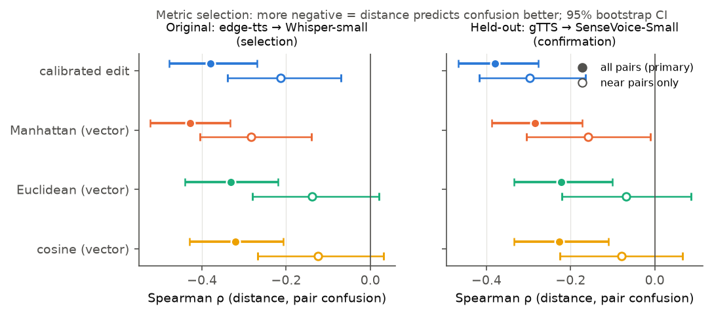
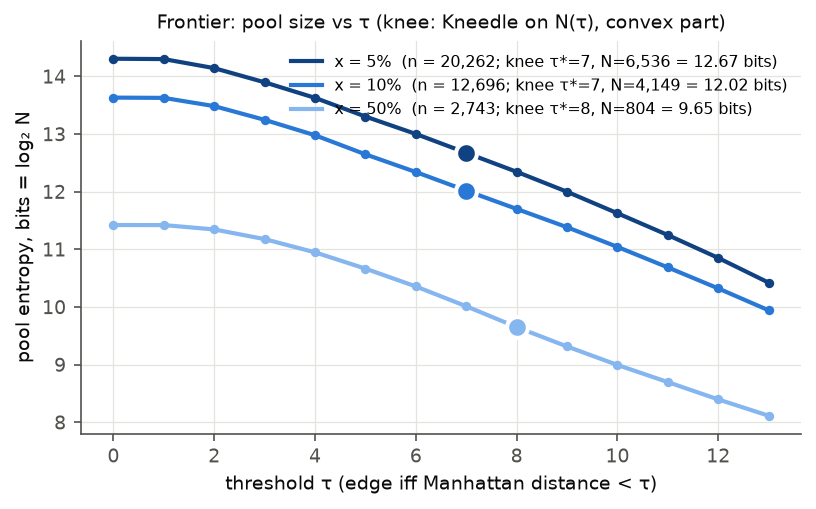
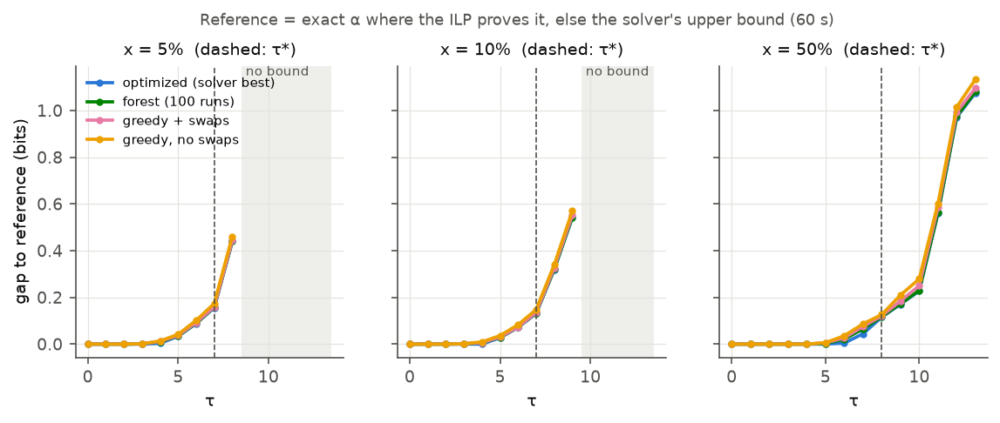
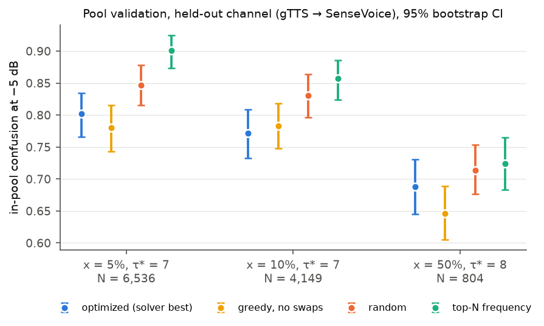

# Countersign pool — results (adopted pipeline: Manhattan distance)

Every number is read from the stage outputs; each figure has its table next to it in this folder.

## Headline (x = 5%)

- Candidate set: **20,262** 2–3-syllable NNG lemmas (OpenSubtitles KO, Kiwi) at or above the bottom-5% Zipf
  of the NIKL anchors (cutoff Zipf 2.68).
- Distance: **Manhattan (L1) on fixed-length articulatory vectors** — chosen over the GLM-calibrated edit distance,
  Euclidean and cosine in §2.
- Knee τ* = **7** (edges = pairs with distance ≤ 6) → pool **N = 6,536,
  12.67 bits**; solver upper bound 7,262 → gap ≤ **726 words
  (0.152 bits)**.
- Held-out pool validation, −5 dB: optimized **0.80**
  [0.766, 0.835] vs random
  0.85 vs top-N frequency 0.90;
  no-swap greedy 0.78 (N = 6,455).

## 1. Calibrating the edit distance (GLM)

The candidate "calibrated edit" distance is a weighted Manhattan edit distance between surface forms: substitution
cost = weighted L1 difference of the 4 articulatory features (consonant: place, manner, laryngeal, sonorant; vowel:
height, backness, round, glide), gap = 3, consonant↔vowel crossing = 6.

**How the weights are fit.** 45,753 word pairs from 320 sampled words were played through the original
channel (edge-tts → Whisper-small, forced choice, 0 / −5 dB, 8 trials); per pair the outcome is the number of
confusions out of the number of presentations. Each pair is aligned under the current weights and summarised as
*per-feature mismatch totals along the alignment* plus counts of gaps and crossings. A **binomial GLM (logit link)**
regresses confusion on those totals, fit on the nearest nearest 10% (n=6525) pairs (far pairs are never confused and
carry no information about weights). A negative coefficient means "a mismatch on this feature makes confusion less
likely", i.e. the feature separates words, so **weight = max(−coef, 0.1)**; a wrong-sign (positive) coefficient is
floored, not flipped. Pairs are then re-aligned under the new weights and the GLM refit until the weights stop
changing (3 iterations). Three candidates — uniform, raw and mean-normalised weights — are
compared by Spearman ρ(distance, confusion) on all pairs; the best is adopted (`calibrated_norm`).

| feature | glm_coef | sign | weight_adopted |
|---|---|---|---|
| c_place | -0.202 | ok | 0.375 |
| c_manner | -0.481 | ok | 0.890 |
| c_laryngeal | -0.201 | ok | 0.373 |
| c_sonorant | -1.267 | ok | 2.345 |
| v_height | -1.058 | ok | 1.958 |
| v_backness | -0.612 | ok | 1.132 |
| v_round | -0.402 | ok | 0.743 |
| v_glide | 0.092 | wrong_sign_floored | 0.185 |

| weights | spearman_d_vs_confusion |
|---|---|
| uniform | -0.126 |
| calibrated_raw | -0.131 |
| calibrated_norm | -0.140 |

Channel error by SNR:

| snr_db | error_rate |
|---|---|
| 0 | 0.496 |
| -5 | 0.809 |

**Reading.** All coefficients but v_glide are negative and significant (v_glide floored), but calibration improves ρ
only from -0.126 (uniform) to -0.140. The weights
matter little; §2 asks whether the edit distance is needed at all.

## 2. Choosing the distance (Fig. 1)

Four distances, all on the same g2pk2 surface forms and the same articulatory features:

| metric | definition |
|---|---|
| calibrated edit | §1, with alignment (handles length differences by gaps) |
| Manhattan | L1 between 45-dim vectors: 3 syllables × (onset, vowel, coda) × (4 features + present bit), left-aligned, zero-padded |
| Euclidean | L2 between the same vectors |
| cosine | 1 − cosine similarity of the same vectors |

**Design (one shared pair set).** Each metric's *near range* = its 20,000 closest pairs (ties at the boundary kept).
50 pairs are drawn at random from each metric's near range plus 50 random pairs → 250 pairs; words used to fit §1
and identical-surface pairs (distance 0 under every metric, 85)
are excluded. Every word passes a clean-audio gate (forced choice against 50 fixed distractors; a failed word's
pair is replaced from a reserve). All evaluated words form **one** candidate set; each is spoken 8× at 0 and −5 dB.
Pair confusion rate = (a heard as b + b heard as a) / (presentations of a + b). Every metric is scored on all 250
pairs, so the comparison is paired.

**Score and significance test.** Spearman ρ(distance, pair confusion rate) over all pairs (primary) and over the
200 near pairs (secondary). Uncertainty: **bootstrap over pairs** (2,000 resamples of the 250 pairs with
replacement; percentile 95% CI). Because all metrics are scored on the same resample, the CI of
**ρ(metric) − ρ(winner)** is a paired test: if it contains 0 the metric is not distinguishable from the winner at
the 5% level. Selection used the **original channel only**; the held-out channel was run afterwards with the same
design as a confirmation and did not influence the choice.

| channel | pairs | words | pairs_with_confusion | error_rate | error_0dB | error_-5dB | gate_replacements | winner |
|---|---|---|---|---|---|---|---|---|
| original | 250 | 481 | 83 | 0.498 | 0.364 | 0.631 | 15 | manhattan |
| heldout | 250 | 482 | 52 | 0.549 | 0.420 | 0.678 | 5 | calibrated_edit |

| channel | metric | rho_all | rho_all_lo | rho_all_hi | rho_near | rho_near_lo | rho_near_hi | minus_winner_lo | minus_winner_hi | rho_0dB | rho_-5dB |
|---|---|---|---|---|---|---|---|---|---|---|---|
| original | calibrated_edit | -0.380 | -0.479 | -0.270 | -0.214 | -0.340 | -0.070 | -0.046 | 0.151 | -0.316 | -0.350 |
| original | manhattan | -0.428 | -0.523 | -0.333 | -0.283 | -0.405 | -0.141 | 0.000 | 0.000 | -0.351 | -0.394 |
| original | euclidean | -0.332 | -0.441 | -0.220 | -0.139 | -0.281 | 0.020 | 0.042 | 0.156 | -0.254 | -0.318 |
| original | cosine | -0.320 | -0.430 | -0.207 | -0.124 | -0.268 | 0.031 | 0.032 | 0.183 | -0.281 | -0.286 |
| heldout | calibrated_edit | -0.380 | -0.468 | -0.277 | -0.298 | -0.417 | -0.165 | 0.000 | 0.000 | -0.332 | -0.347 |
| heldout | manhattan | -0.284 | -0.387 | -0.172 | -0.158 | -0.306 | -0.010 | -0.021 | 0.213 | -0.226 | -0.239 |
| heldout | euclidean | -0.222 | -0.335 | -0.101 | -0.069 | -0.221 | 0.086 | 0.016 | 0.299 | -0.162 | -0.181 |
| heldout | cosine | -0.227 | -0.335 | -0.111 | -0.079 | -0.226 | 0.066 | 0.015 | 0.292 | -0.176 | -0.192 |

- Original: Manhattan ρ = -0.428, calibrated edit -0.380;
  difference CI [-0.046, 0.151] → **tied**. Euclidean and cosine are significantly worse
  ([0.042, 0.156], [0.032, 0.183]).
- Held-out: calibrated edit ρ = -0.380, Manhattan -0.284;
  difference CI [-0.021, 0.213] → **tied, order reversed**. Euclidean and cosine again
  significantly worse.
- **Decision:** Manhattan and calibrated edit are statistically indistinguishable on both channels; Manhattan is
  adopted because it won on the selection channel and is simpler (no listening data, no fitted weights, no
  alignment). Euclidean and cosine are rejected on both channels.
- Random pairs were never confused on either channel; all signal comes from near pairs.

## 3. Grid, frontier and knees (Figs. 2–3)

42 cells = x ∈ {5, 10, 50} × τ ∈ {0, 1, …, 13}; edge iff Manhattan distance < τ
(distances are integers, so τ = 7 means distance ≤ 6). Per cell: ILP (CP-SAT, 60 s) on the giant component, greedy +
swaps, forest (100 randomised runs), no-swap greedy; ties broken by frequency. Per-cell N, bits, gap, components and
runtimes: `table_grid_cells.csv`.

- **Knee rule.** N(τ) is S-shaped (flat at τ ≤ 1, where only identical vectors connect; steepest drop; convex tail).
  Kneedle (convex, decreasing) is applied from the steepest drop onward. bits(τ) has no knee (≈ linear).
- Exact α proven up to τ = 3 (x=5), 4 (x=10), 5 (x=50); beyond that the 60 s ILP gives an
  upper bound only, and the gap shown is mostly looseness of the bound.
- No bound: ILP returned UNKNOWN at τ=9 (x=5), τ=10 (x=5), τ=10 (x=10), τ=11 (x=10);
  model not built (giant component > 1,500,000 edges, 5.9 GB RAM) at
  τ=11 (x=5), τ=12 (x=5), τ=13 (x=5), τ=12 (x=10), τ=13 (x=10).
- Method order: solver best ≥ forest ≥ greedy + swaps ≥ no-swap greedy in every cell; all within ~1% of each other
  at the knees.

| x | tau_star | fit | n | edges | components | giant | ILP | reference | N | bits | gap_words | gap_bits | N_forest | N_greedy | N_greedy_noswap | sec_ilp | sec_cell |
|---|---|---|---|---|---|---|---|---|---|---|---|---|---|---|---|---|---|
| 5.000 | 7.000 | convex from tau=2 | 20262 | 388864 | 2819 | 16739 | FEASIBLE | 7262 | 6536 | 12.674 | 726 | 0.152 | 6530 | 6520 | 6455 | 184.106 | 208.130 |
| 10.000 | 7.000 | convex from tau=2 | 12696 | 201644 | 1886 | 10362 | FEASIBLE | 4530 | 4149 | 12.019 | 381 | 0.127 | 4143 | 4137 | 4101 | 189.869 | 201.622 |
| 50.000 | 8.000 | convex from tau=4 | 2743 | 33715 | 258 | 2449 | FEASIBLE | 871 | 804 | 9.651 | 67 | 0.115 | 803 | 801 | 798 | 84.941 | 87.906 |

## 4. Pool validation (held-out channel, Fig. 4)

The listener (gTTS → SenseVoice-Small) chooses among the **whole pool**; 300 spoken words per pool, −5 / −10 dB.
Baselines of equal N: random words from the same candidate set, and the N most frequent words.

| x | pool | N | bits | spoken | not_spoken_unrepresentable | clean_self_recognition | conf_-5dB | ci_lo_-5dB | ci_hi_-5dB | conf_-10dB | ci_lo_-10dB | ci_hi_-10dB |
|---|---|---|---|---|---|---|---|---|---|---|---|---|
| 5.000 | optimized | 6536 | 12.674 | 300 | 213 | 0.997 | 0.802 | 0.766 | 0.835 | 0.986 | 0.979 | 0.993 |
| 5.000 | greedy_noswap | 6455 | 12.656 | 300 | 227 | 0.970 | 0.780 | 0.743 | 0.816 | 0.979 | 0.968 | 0.988 |
| 5.000 | random | 6536 | 12.674 | 300 | 133 | 0.917 | 0.847 | 0.816 | 0.878 | 0.994 | 0.988 | 0.998 |
| 5.000 | top_freq | 6536 | 12.674 | 300 | 49 | 0.913 | 0.901 | 0.874 | 0.925 | 0.990 | 0.980 | 0.998 |
| 10.000 | optimized | 4149 | 12.019 | 300 | 92 | 0.987 | 0.771 | 0.733 | 0.808 | 0.979 | 0.968 | 0.989 |
| 10.000 | greedy_noswap | 4101 | 12.002 | 300 | 88 | 0.967 | 0.783 | 0.748 | 0.818 | 0.983 | 0.973 | 0.991 |
| 10.000 | random | 4149 | 12.019 | 300 | 61 | 0.943 | 0.831 | 0.797 | 0.864 | 0.989 | 0.982 | 0.995 |
| 10.000 | top_freq | 4149 | 12.019 | 300 | 10 | 0.913 | 0.857 | 0.824 | 0.886 | 0.992 | 0.987 | 0.996 |
| 50.000 | optimized | 804 | 9.651 | 300 | 2 | 0.987 | 0.688 | 0.645 | 0.731 | 0.972 | 0.960 | 0.983 |
| 50.000 | greedy_noswap | 798 | 9.640 | 300 | 2 | 0.993 | 0.646 | 0.605 | 0.689 | 0.958 | 0.943 | 0.971 |
| 50.000 | random | 804 | 9.651 | 300 | 2 | 0.973 | 0.714 | 0.677 | 0.754 | 0.960 | 0.944 | 0.976 |
| 50.000 | top_freq | 804 | 9.651 | 300 | 0 | 0.973 | 0.724 | 0.683 | 0.765 | 0.975 | 0.963 | 0.986 |

- x = 5 and 10: optimized < random < top-N frequency; optimized vs random CIs just touch (modest effect).
- x = 50: optimized, random and top-N overlap — no measurable difference at N = 804.
- No-swap greedy matches optimized at every x: the solver's gain is pool size, not lower confusion.
- −10 dB is at the floor (≥ 0.96) in every pool; −5 dB is the informative SNR.
- Error is much higher than in the superseded pipeline (appendix) because the pools are larger (more alternatives
  per forced choice), not because the pools are worse.

## Notes for the paper

1. **Distance choice is a tie.** Report Manhattan as "not worse than the calibrated edit distance on either channel,
   and simpler", not as "best".
2. **Weak calibration.** Learned weights add little over uniform (ρ -0.126 →
   -0.140); only 648 of 45,753 pairs were ever confused.
3. **Unrepresentable words.** SenseVoice's tokenizer cannot write some words; they stay in the pool but are not spoken.
   At x = 5 this is 213 words in the optimized pool,
   227 no-swap, 133 random,
   49 top-N — the optimizer favours rare/odd forms. This affects
   which words are spoken and must be disclosed; at x = 50 it is ≤ 2 words.
4. **Bounds at the knee.** τ* lies beyond the range where the 60 s ILP proves α; the knee gaps are upper bounds
   (0.152 bits at x = 5).
5. **Bugs fixed vs the notebook:** GLM sign convention; re-alignment under fitted weights; clean-audio gate against
   fixed distractors; gate-failed pairs replaced; SNR on active speech; deterministic noise seeds; ILP status reported
   (exact vs bound); knee-shape detection (the first version labelled S-shaped curves concave and returned the grid
   edge — fixed before pool validation).

## Appendix — superseded edit-distance pipeline

Same steps with the earlier calibrated edit distance (τ grid 0–6 in steps of 0.25, 1 h ILP at knees).
At x = 50 its knee was chosen with the earlier, buggy shape rule (τ* = 2.5; the fixed rule gives
2.75); x = 5 and 10 are unchanged. Not re-run.

| x | tau_star | N | bits | gap_words | conf_-5dB_optimized | conf_-5dB_greedy_noswap | conf_-5dB_random | conf_-5dB_top_freq |
|---|---|---|---|---|---|---|---|---|
| 5.000 | 2.250 | 5485 | 12.421 | 409 | 0.652 | 0.601 | 0.732 | 0.810 |
| 10.000 | 2.250 | 3529 | 11.785 | 164 | 0.554 | 0.596 | 0.763 | 0.771 |
| 50.000 | 2.500 | 754 | 9.558 | 25 | 0.510 | 0.522 | 0.598 | 0.646 |
